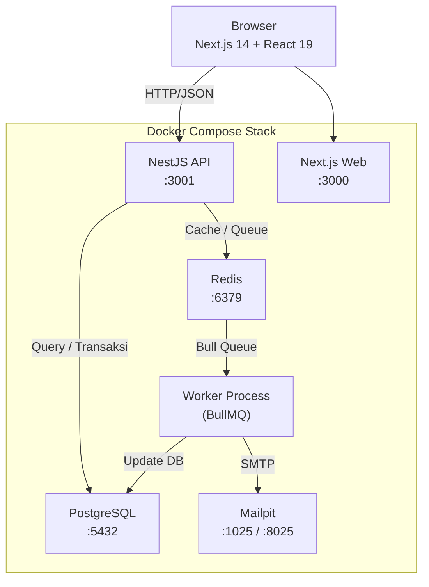

# ARCHITECTURE.md — Dokumentasi Arsitektur Sistem

## Diagram Arsitektur



---

## Struktur Direktori

```
/
├── apps/
│   ├── api/                  # Backend NestJS
│   │   ├── prisma/
│   │   │   ├── schema.prisma
│   │   │   ├── migrations/
│   │   │   └── seed.ts
│   │   └── src/
│   │       ├── main.ts
│   │       ├── app.module.ts
│   │       ├── common/
│   │       │   ├── prisma.service.ts
│   │       │   ├── redis.service.ts
│   │       │   ├── email.service.ts
│   │       │   ├── interceptors/
│   │       │   │   └── audit.interceptor.ts
│   │       │   └── middleware/
│   │       │       └── request-id.middleware.ts
│   │       └── modules/
│   │           ├── auth/
│   │           ├── products/
│   │           ├── customers/
│   │           ├── orders/
│   │           │   ├── order-state.machine.ts
│   │           │   ├── orders.controller.ts
│   │           │   ├── orders.service.ts
│   │           │   └── dto/
│   │           ├── reports/
│   │           ├── audit/
│   │           ├── jobs/
│   │           │   └── processors/
│   │           │       ├── invoice.processor.ts
│   │           │       └── notification.processor.ts
│   │           └── health/
│   └── web/                  # Frontend Next.js
│       └── src/
│           ├── app/
│           │   ├── (authenticated)/
│           │   │   ├── dashboard/
│           │   │   ├── orders/
│           │   │   ├── products/
│           │   │   ├── customers/
│           │   │   ├── reports/
│           │   │   └── monitoring/
│           │   └── login/
│           ├── components/
│           └── lib/
│               ├── api.ts    # Axios instance + semua API calls
│               └── store.ts  # Zustand auth store
├── .github/workflows/ci.yml
├── docker-compose.yml
├── pnpm-workspace.yaml
└── pnpm-lock.yaml
```

---

## Layer Arsitektur Backend

### 1. Controller Layer (`src/modules/*/**.controller.ts`)
Bertanggung jawab atas:
- Routing HTTP dan validasi DTO (`class-validator`)
- Ekstraksi parameter (query, param, header, body)
- Tidak mengandung logika bisnis — semua didelegasikan ke service

### 2. Service Layer (`src/modules/*/**.service.ts`)
Bertanggung jawab atas:
- Semua logika bisnis domain
- Manajemen transaksi database (`prisma.$transaction`)
- Kontrol concurrency (pessimistic lock)
- Idempotency check
- Cache invalidation Redis
- Enqueue job BullMQ

### 3. Domain Layer (`order-state.machine.ts`)
- Class `OrderStateMachine` dengan tabel transisi eksplisit
- Memvalidasi transisi status + role yang diizinkan
- Melempar `ConflictException` untuk transisi yang tidak valid
- Terpisah dari service agar bisa diuji secara independen

### 4. Infrastructure Layer (`src/common/`)
- `PrismaService`: wrapper singleton Prisma client
- `RedisService`: wrapper Redis dengan graceful degradation (jika Redis mati, sistem tetap jalan)
- `EmailService`: Nodemailer ke Mailpit
- `AuditInterceptor`: logging otomatis semua request ke tabel `audit_logs`
- `RequestIdMiddleware`: injeksi `X-Request-Id` ke setiap request/response

---

## Architecture Decision Records (ADR)

### ADR-1: Strategi Konsistensi Stok (Pessimistic Locking)

**Konteks:**
Dua kasir bisa membuat order untuk produk yang sama secara bersamaan. Sistem tidak boleh overselling — stok tidak boleh menjadi negatif meski ada banyak request paralel.

**Opsi yang Dipertimbangkan:**

| Opsi | Pro | Kontra |
|------|-----|--------|
| Pessimistic Lock (`SELECT FOR UPDATE`) | Koreksi terjamin, mudah dipahami | Latency sedikit lebih tinggi pada load ekstrem |
| Optimistic Lock (version field + retry) | Throughput lebih tinggi | Logika retry kompleks, bisa confusing ke user |
| Serial Queue (BullMQ) | Ordering terjamin | Latency tidak diterima user (~5–30 detik) |

**Keputusan:** Pessimistic Locking dengan `SELECT FOR UPDATE`.

**Implementasi** (`apps/api/src/modules/orders/orders.service.ts`):
```typescript
// Sort product ID sebelum lock untuk mencegah deadlock
const sortedProductIds = [...requestedItems.keys()].sort(
  (a, b) => (a < b ? -1 : a > b ? 1 : 0)
);

for (const productId of sortedProductIds) {
  await tx.$queryRaw`SELECT id FROM products WHERE id = ${productId} FOR UPDATE`;
}
```

**Pencegahan Deadlock:**
- Lock selalu diambil dalam urutan ID produk yang terurut (ascending)
- Jika dua order memesan produk A dan B, keduanya akan selalu mengunci A dulu baru B — tidak pernah bersilang
- Transaksi dibuat sesingkat mungkin (tidak ada I/O eksternal di dalam transaksi)

**Konsekuensi:**
- ✅ Tidak ada overselling dalam 100+ test run concurrency
- ✅ Mudah di-debug (tidak ada retry logic)
- ⚠️ Jika ada 10.000+ order bersamaan untuk produk yang sama, baris antrian lock bisa menumpuk — pada titik itu perlu dipertimbangkan queue-based ordering

---

### ADR-2: Desain Idempotency (Tabel PostgreSQL)

**Konteks:**
Client bisa mengirim ulang request `POST /api/orders` akibat timeout atau error jaringan. Sistem harus memastikan order hanya dibuat sekali meski request dikirim berkali-kali dengan key yang sama.

**Opsi yang Dipertimbangkan:**

| Opsi | Pro | Kontra |
|------|-----|--------|
| Tabel `idempotency_keys` di PostgreSQL | Durable, konsisten dengan transaksi DB | Overhead query tambahan |
| Redis key-value | Cepat, TTL otomatis | Data hilang jika Redis restart |
| In-memory (Map) | Paling cepat | Tidak bekerja di multi-instance |

**Keputusan:** Tabel `idempotency_keys` di PostgreSQL.

**Alasan:** Data order adalah data bisnis kritis — durabilitas lebih penting dari kecepatan lookup. Redis bisa down atau di-flush; tabel PostgreSQL tidak.

**Implementasi** (`apps/api/src/modules/orders/orders.service.ts`):
```typescript
// Cek apakah request pernah diproses
const existing = await prisma.idempotencyKey.findUnique({ where: { key } });

if (existing) {
  if (existing.status === 202) throw new ConflictException('Masih diproses');
  return JSON.parse(existing.response); // Return respons yang tersimpan
}

// Tandai sebagai "sedang diproses" (202)
await prisma.idempotencyKey.create({ data: { key, status: 202, expiresAt: +24h } });

try {
  const result = await prosesOrder();
  await prisma.idempotencyKey.update({ where: { key }, data: { status: 201, response: JSON.stringify(result) } });
  return result;
} catch (err) {
  await prisma.idempotencyKey.update({ where: { key }, data: { status: 409 } });
  throw err;
}
```

**Perilaku:**
- Key yang sama + payload sama → kembalikan respons tersimpan (tidak buat order baru)
- Key yang sama + sedang diproses → tolak dengan 409
- Key kadaluarsa setelah 24 jam

**Konsekuensi:**
- ✅ Aman dari double-submit dan retry otomatis client
- ✅ Tahan restart server dan Redis
- ⚠️ Perlu cleanup job untuk hapus key yang sudah expired (saat ini belum diimplementasi, akan menumpuk di DB setelah berbulan-bulan)

---

### ADR-3: Strategi Autentikasi (JWT Refresh Token Rotation)

**Konteks:**
Sistem memerlukan autentikasi stateless yang aman untuk dua role (admin, cashier) dengan akses dari web browser.

**Opsi yang Dipertimbangkan:**

| Opsi | Pro | Kontra |
|------|-----|--------|
| Access token umur panjang (24 jam) | UX lebih baik (jarang login ulang) | Risiko keamanan jika token bocor |
| Refresh Token Rotation | Keseimbangan keamanan dan UX | Implementasi lebih kompleks |
| Session cookie | CSRF protection lebih baik | Tidak cocok untuk SPA + API terpisah |

**Keputusan:** Refresh Token Rotation.

**Implementasi** (`apps/api/src/modules/auth/auth.service.ts`):
- Access token: expire 15 menit (minimal damage jika bocor)
- Refresh token: expire 7 hari, dibuat baru setiap digunakan
- Client menyimpan keduanya di `localStorage`, refresh otomatis via Axios interceptor

**Konsekuensi:**
- ✅ Access token pendek meminimalkan window serangan
- ✅ Refresh token rotation mencegah replay attack
- ⚠️ `localStorage` rentan XSS — untuk produksi disarankan `httpOnly cookie`. Saat ini diterima karena Helmet + CORS sudah dikonfigurasi.

---

## Skalabilitas: Jika 50.000 Order/Hari

Kapasitas saat ini cocok untuk ~500–2.000 order/hari (single-node). Untuk skala 50.000 order/hari dari banyak cabang:

**Database:**
- Partisi tabel `orders` by `order_date` (range partitioning per bulan)
- Read replica PostgreSQL untuk endpoint laporan dan dashboard
- Archive order lama ke tabel `orders_archive` (>1 tahun)
- Connection pooling via PgBouncer

**Cache:**
- Redis Cluster (minimal 3 node) untuk HA
- Pisahkan Redis instance: satu untuk cache, satu untuk BullMQ queue

**Queue:**
- Scale worker container secara horizontal (tambah replika `worker` di Compose/K8s)
- Monitor queue depth dan latency per job type

**API:**
- Horizontal scaling (3+ replika) di belakang load balancer
- Sticky session tidak diperlukan karena stateless JWT

**Idempotency:**
- Tambah cleanup job terjadwal untuk hapus `idempotency_keys` yang sudah expired
- Atau pindahkan ke Redis dengan TTL otomatis jika sudah ada Redis Cluster HA

**Frontend:**
- CDN untuk static asset Next.js
- Kurangi polling interval atau ganti dengan WebSocket/SSE untuk notifikasi real-time

---

## Observabilitas

### Request Tracing
Setiap request mendapat `X-Request-Id` dari middleware (`request-id.middleware.ts`) yang dikembalikan di response header.

### Audit Log Otomatis
`AuditInterceptor` mencatat semua request yang berhasil ke tabel `audit_logs` secara otomatis, termasuk: action, entityType, entityId, userId, durasi, dan deskripsi.

### Health Check
`GET /api/health` mengecek koneksi PostgreSQL dan Redis, mengembalikan status masing-masing.

### Cache Dashboard
Dashboard summary di-cache di Redis dengan TTL 5 menit. Invalidasi otomatis terjadi setiap kali ada perubahan status order atau penyesuaian stok.

---

## Keputusan Schema Database

### Mengapa BigInt untuk `orders.id` dan UUID untuk `customers.id`?
- **Orders**: BigInt karena volume tinggi dan butuh urutan yang deterministic (order number generation)
- **Customers**: UUID karena ID customer bisa di-expose ke client tanpa mengungkap jumlah total customer

### Mengapa Soft Delete?
Produk dan customer tidak dihapus secara fisik (`deleted_at` nullable). Alasannya: order history harus tetap bisa diakses meski produk/customer sudah "dihapus". Hard delete akan merusak foreign key dan audit trail.

### Index yang Ditambahkan
```sql
-- Filter order by status (laporan, dashboard)
CREATE INDEX orders_status_idx ON orders(status);

-- Filter order by tanggal (laporan penjualan)
CREATE INDEX orders_order_date_idx ON orders("orderDate");

-- Soft delete filter (hampir semua query produk/customer)
CREATE INDEX products_deleted_at_idx ON products("deletedAt");
CREATE INDEX customers_deleted_at_idx ON customers("deletedAt");

-- Audit log query by action/entity
CREATE INDEX audit_logs_action_idx ON audit_logs(action);
CREATE INDEX audit_logs_entity_type_idx ON audit_logs("entityType");
```

---

*Terakhir diperbarui: November 2026*
